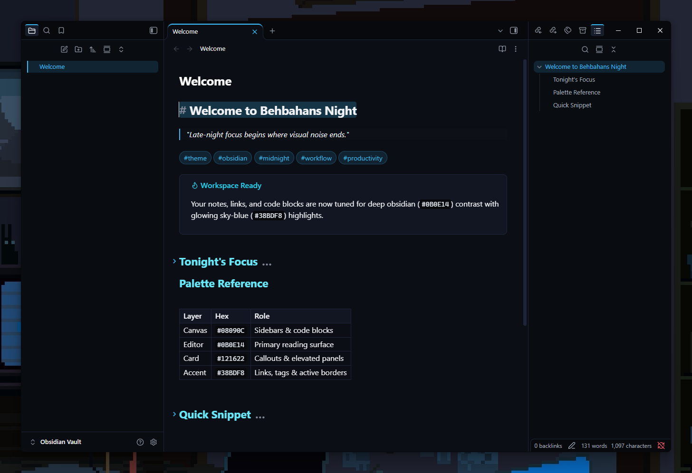

# Behbahans Night for Obsidian

A cozy, late-night dark theme featuring deep obsidian navy backgrounds (#08090C / #0B0E14) and glowing sky-blue (#38BDF8) accents.

Part of the [Behbahans Night](https://github.com/Acid-hastam/Behbahans_night) theme suite.

## Installation

1. Open **Settings → Appearance → Themes → Manage** in Obsidian.
2. Search for **Behbahans Night** and click **Install and use**.

## License

MIT License — see [LICENSE](LICENSE).